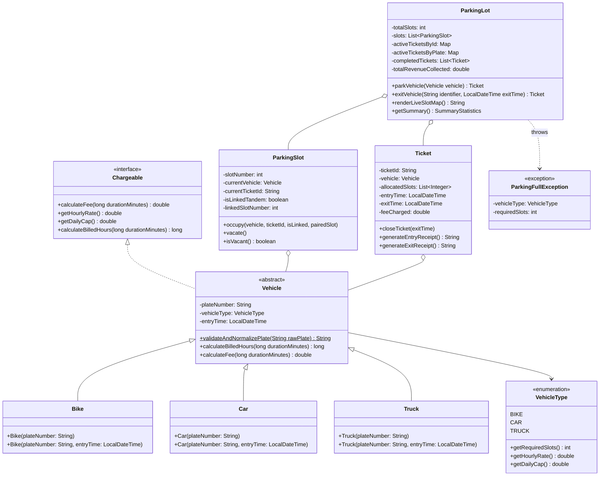

# ParkEase — Smart Parking Lot Management & Billing System

**ParkEase** is a production-grade, object-oriented smart parking management and automated billing system built in Java 21. It provides validated multi-vehicle parking, duplicate-entry prevention, intelligent slot allocation (including consecutive multi-slot reservation for heavy vehicles), partial-hour ceil billing, daily charge caps, real-time visual slot mapping, and lifecycle reporting.

---

## 🏛️ Architectural Design & OOP Model

The system strictly adheres to clean Object-Oriented Design principles:



---

## 🚗 Vehicle Specifications & Pricing Rules

| Vehicle Type | Slots Required | Hourly Rate | 24-Hour Daily Cap (8h Max) | Allocation Behavior |
| :--- | :---: | :---: | :---: | :--- |
| **Bike** (`BIKE`) | 1 Slot | **Rs. 10 / hr** | **Rs. 80 / day** | First available vacant slot |
| **Car** (`CAR`) | 1 Slot | **Rs. 30 / hr** | **Rs. 240 / day** | First available vacant slot |
| **Truck** (`TRUCK`) | **2 Consecutive Slots** | **Rs. 60 / hr** | **Rs. 480 / day** | Must occupy 2 adjacent contiguous vacant slots (e.g. `[S-04, S-05]`) |

### 🧮 Billing Formula

1. **Partial Hour Rounding Up**:
   $$\text{Billed Hours} = \max\left(1, \left\lceil \frac{\text{Duration in Minutes}}{60} \right\rceil\right)$$
   *Example:* 10 minutes $\to$ 1 hour; 65 minutes $\to$ 2 hours; 125 minutes $\to$ 3 hours.

2. **Daily Charge Cap per 24-Hour Period (FR-6: max 8 hours charge)**:
   $$\text{Full Days} = \lfloor \text{Billed Hours} / 24 \rfloor$$
   $$\text{Remainder Hours} = \text{Billed Hours} \pmod{24}$$
   $$\text{Total Fee} = (\text{Full Days} \times \text{Daily Cap}) + \min\left(\text{Remainder Hours} \times \text{Hourly Rate}, \text{Daily Cap}\right)$$
   *Example (Car parked 3 hours):* $3 \times \text{Rs. } 30 = \text{Rs. } 90$.  
   *Example (Car parked 9 hours):* $9 \times \text{Rs. } 30 = \text{Rs. } 270 \to$ capped at **Rs. 240**.  
   *Example (Car parked 26 hours):* 1 full day ($\text{Rs. } 240$) + 2 remainder hours ($2 \times \text{Rs. } 30 = \text{Rs. } 60$) = **Rs. 300**.

---

## 🗄️ Database Management Systems (DBMS) Integration (R2023 IT Syllabus)

ParkEase comes with a full **SQLite3 / MySQL RDBMS persistence engine** implementing Units I, II, III, IV, and V of the R2023 Anna University / REC curriculum:
- **`schema.sql`**: Full DDL schema with primary keys, foreign keys, 3NF decomposition, B-Tree indexes, and views (`vw_active_parking`, `vw_revenue_summary`).
- **`parkease.db`**: Auto-generated zero-configuration SQLite database.
- **`DBMS_PROJECT_REPORT.md`**: Complete report covering ER model, 1NF/2NF/3NF/BCNF normalization proofs, ACID transactions, and NoSQL/MongoDB document comparison.

## 🛡️ Edge Cases Handled

1. **Registration Plate Validation & Normalization**:
   - Accepts standard formats with spaces, hyphens, and mixed casing (e.g., `MH-12-AB-1234`, `dl 01 c 9999`, `ka05mb9876`).
   - Normalizes to clean uppercase without separators.
   - Rejects malformed strings (`INVALID123`, `1234`, empty/null) with clear feedback.
2. **Duplicate Entry Prevention**:
   - Validates incoming plates against actively parked vehicles.
   - Throws `IllegalArgumentException` displaying the existing ticket ID and occupied slot if a duplicate vehicle attempts entry.
3. **Truck Consecutive Slot Allocation**:
   - Searches for adjacent slot pairs `[S_i, S_{i+1}]`.
   - Links slots bidirectionally (`isLinkedTandem = true`).
4. **Truck Fragmentation (`ParkingFullException`)**:
   - If individual slots are free but no 2 are adjacent (e.g., 2 free slots separated by parked cars), a `ParkingFullException` is raised detailing that consecutive slots are unavailable.
5. **Full Lot (`ParkingFullException`)**:
   - Rejects entry with `ParkingFullException` when all slots are occupied.
6. **Time-Machine Simulator**:
   - Supports testing departure using current clock time or simulating elapsed durations (e.g., enter `2.5` hours or `28` hours) to immediately verify rounding and daily caps.

---

## 📁 Project Structure

```
ParkEase/
├── src/
│   └── com/
│       └── parkease/
│           ├── billing/
│           │   └── Chargeable.java          # Billing contract interface
│           ├── exception/
│           │   └── ParkingFullException.java# Custom checked exception
│           ├── model/
│           │   ├── Bike.java                # Bike vehicle subclass
│           │   ├── Car.java                 # Car vehicle subclass
│           │   ├── ParkingSlot.java         # Slot model with tandem tracking
│           │   ├── SummaryStatistics.java   # Snapshot metrics record
│           │   ├── Ticket.java              # Ticket model with ASCII receipts
│           │   ├── Truck.java               # Truck vehicle subclass
│           │   ├── Vehicle.java             # Abstract parent class
│           │   └── VehicleType.java         # Enum with rates and caps
│           ├── service/
│           │   └── ParkingLot.java          # Main allocation & billing engine
│           ├── test/
│           │   └── TestRunner.java          # 10 automated unit test scenarios
│           ├── ui/
│           │   └── ParkEaseApp.java         # Interactive CLI application
│           ├── db/
│           │   └── DatabaseManager.java     # SQLite JDBC persistence & schema initialization
│           ├── demo/
│           │   └── LiveDemonstrator.java    # Automated live walkthrough demo
│           └── util/
│               └── AnsiColor.java           # Claude terracotta dull orange ANSI utilities
├── lib/                                     # SQLite JDBC & SLF4J Driver libraries
├── build.sh / build.bat / build.ps1         # Cross-platform compilation scripts
├── run.sh / run.bat / run.ps1               # Cross-platform interactive launcher
├── demo.sh / demo.bat / demo.ps1            # Cross-platform automated live demo runner
└── README.md
```

---

## 🚀 How to Build and Run

### 1. Compile the Project
On macOS / Linux:
```bash
./build.sh
```
On Windows (PowerShell or Command Prompt):
```powershell
.\build.ps1
# or
build.bat
```

### 2. Run the Interactive Application
On macOS / Linux:
```bash
./run.sh
```
On Windows (PowerShell or Command Prompt):
```powershell
.\run.ps1
# or
run.bat
```

### 3. Run the Automated Live Demo
To watch the smart parking system operate autonomously (allocating bays, showing tandem trucks, calculating bills, and vacating slots):
On macOS / Linux:
```bash
./demo.sh
```
On Windows (PowerShell or Command Prompt):
```powershell
.\demo.ps1
# or
demo.bat
```
